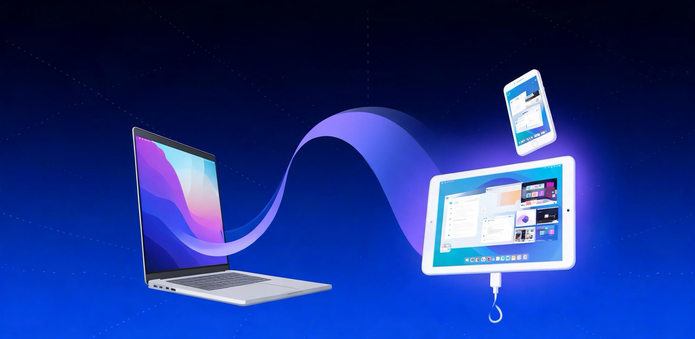

<h1 align="center">LanScreen</h1>

<p align="center"><strong>Turn any phone or tablet into a real second monitor for your Mac.</strong><br>
<strong>把任何手机或平板变成 Mac 的扩展副屏 —— 副屏上无需安装任何软件。</strong></p>

<p align="center">
  <a href="https://lanscreen.deepthink.ltd/">Website</a> ·
  <a href="https://github.com/horizon365/LanScreen/releases/latest">Download</a> ·
  <a href="#english">English</a> ·
  <a href="#简体中文">简体中文</a>
</p>

<p align="center"></p>

---

## English

### What is LanScreen?

LanScreen is a free macOS menu-bar app that turns almost any device you already own — an Android tablet, an iPad, or an older phone — into a **real extended second monitor for your Mac**, using nothing but a browser on the second screen. There is **nothing to install** on the phone or tablet, no account to create, and no internet connection involved: frames travel directly over your local network or a USB cable.

Mirroring and casting tools only duplicate what is already on your Mac. LanScreen creates a genuine HiDPI virtual display that macOS lists in **System Settings → Displays** exactly like a physical monitor — you extend your desktop onto it, drag windows over, and work across two screens as usual. Think of it as a cross-device alternative to Sidecar and Duet, without the device lock-in: Sidecar only pairs with an iPad, Duet needs a client app on the second screen, while LanScreen works with any device that has a modern browser.

### Highlights

- **A real extended display, not a mirror** — up to 2960×1848 HiDPI; macOS treats it as a system display.
- **Sharp and smooth** — 60 fps end to end: hardware H.264 encode (VideoToolbox), hardware decode (WebCodecs) and WebGL rendering.
- **Nothing to install on the second device** — open the pairing address in the browser; no app, no account.
- **USB wired mode for near-zero latency** — frames travel over the cable, immune to Wi-Fi jitter, and the device charges while it works.
- **Works with any modern browser** — Android tablets and phones, iPad and iPhone, on Safari, Chrome, Edge or Samsung Internet.
- **Local and private** — peer-to-peer inside your LAN, no servers in the middle, no third-party SDK, no data collected.
- **Free, offline and open** — no sign-up, no tracking.

### How it works

```
macOS (LanScreen.app)
  CGVirtualDisplay  →  ScreenCaptureKit  →  VideoToolbox H.264 encoder
  (virtual monitor)     (60 fps capture)     (low-latency rate control)
                              |
                Embedded HTTP + WebSocket server (ports 8080 / 8081)
                              |
                  Wi-Fi (LAN)  or  USB cable
                              |
Second screen's browser
  WebSocket → WebCodecs VideoDecoder → WebGL canvas
  full screen  +  wake lock  +  automatic reconnect  (one static page / PWA)
```

### Download

| File | Mac |
| --- | --- |
| [LanScreen-1.1-arm64.dmg](https://github.com/horizon365/LanScreen/releases/latest/download/LanScreen-1.1-arm64.dmg) | Apple silicon (M1 / M2 / M3 / M4) |
| [LanScreen-1.1-x86_64.dmg](https://github.com/horizon365/LanScreen/releases/latest/download/LanScreen-1.1-x86_64.dmg) | Intel |

Not sure which to pick? Open the Apple menu → **About This Mac** and look at the **Chip** line: “Apple M…” means Apple silicon, “Intel” means Intel.

The app is ad-hoc signed, not notarized, so macOS blocks it once:

1. Open the DMG and drag **LanScreen** into **Applications**.
2. On macOS 14, right-click the app and choose **Open**; on macOS 15 or later, allow it under **System Settings → Privacy & Security → Open Anyway**.
3. Approve **Screen Recording** when macOS asks.

### Requirements

- **Mac** — macOS 14 or later; Apple silicon or Intel. Screen Recording permission is required.
- **Second screen** — any device with a WebCodecs-capable browser: Safari (macOS, iOS, iPadOS), Chrome, Edge, or Samsung Internet. Nothing to install.
- **Wired mode (optional)** — an Android device with USB debugging enabled, plus `adb` on the Mac.

### Quick start

1. **Run LanScreen on your Mac.** A menu-bar icon appears, macOS gains a new virtual display, and a pairing card shows the address.
2. **Open that address in a browser** on the phone or tablet — `http://<your-mac-ip>:8080` (or `http://localhost:8080` in wired mode). The link is established instantly.
3. **Drag windows over.** Extend your desktop, go full screen, and arrange the new display under System Settings → Displays like any monitor.

### USB low-latency mode

Connect an Android device over USB, choose **Use a cable** from the LanScreen menu, and the app sets up port forwarding for you:

```
adb reverse tcp:8080 tcp:8080
adb reverse tcp:8081 tcp:8081
```

Then open `http://localhost:8080` on the device. Frames travel over the cable instead of Wi-Fi — ideal for gaming, live preview and presentations.

### FAQ

**How is this different from Sidecar or Duet?**
LanScreen doesn’t care what the second device is — an Android tablet, an older iPad, even a phone will do — and there is **nothing to install** on it, just a browser. Sidecar only pairs with an iPad, and Duet needs a client app on the second screen.

**Does it support iPhone and iPad?**
Yes — and **no browser settings are needed**. Open Safari on iOS or iPadOS and connect over Wi-Fi, right out of the box. The wired low-latency mode is currently Android-only.

**How are latency and image quality?**
Typically tens of milliseconds over LAN, and lower still in wired mode. Resolution ranges from 2960×1848 HiDPI down to 1480×924, at 60 fps by default.

**Is it safe? Are ports exposed to the internet?**
No. The service only listens on your local network (ports 8080 / 8081) and opens nothing to the internet; even devices on the same subnet need to know your pairing address to connect.

**Why is copyright-protected video (Netflix, Apple TV+) black?**
DRM-guarded playback is protected by the system, so screen capture only receives black frames. Regular web pages, documents, code editors and dev tools are unaffected.

**Can I use it over Wi-Fi instead of a cable?**
Yes — the second screen just has to share a local network with your Mac. **Safari on macOS / iOS / iPadOS works out of the box, no settings needed.** If you use Chrome or Edge on Android over LAN HTTP, the browser may ask for a trusted connection — in that case enable the browser's "treat insecure origin as secure" flag, or use the USB wired mode instead. For the lowest latency and the most stable result, USB wired mode is still recommended.

### Known limitations

- Display output only — tablet touch / S Pen cannot control the Mac yet.
- A single client at full quality; no audio.
- While streaming, DRM-protected playback blanks on every display.

### Links

- Website — https://lanscreen.deepthink.ltd/
- Releases — https://github.com/horizon365/LanScreen/releases

---

## 简体中文

### LanScreen 是什么？

LanScreen 是一款免费的 macOS 菜单栏应用，把手边**任何一台设备**——安卓平板、iPad，甚至一部旧手机——变成 Mac 的**真正的扩展副屏**，副屏上**不需要安装任何应用**，只要打开浏览器即可。无需注册账号，也无需联网：画面只在你的局域网或一根数据线内传输。

投屏工具只是把 Mac 画面复制一份，而 LanScreen 会创建一块 macOS 认可的 HiDPI 虚拟显示器，出现在「系统设置 → 显示器」里，和普通外接屏完全一样。你可以把桌面扩展过去、拖动窗口、全屏运行。它可以看作跨设备的 Sidecar / Duet 替代方案：Sidecar 只能配 iPad，Duet 要在副屏上装客户端，而 LanScreen 只要求副屏有一个现代浏览器。

### 亮点

- **真·扩展显示器，而不是投屏** —— 最高 2960×1848 HiDPI，被 macOS 识别为系统显示器。
- **清晰顺滑** —— 端到端 60 fps：VideoToolbox 硬件编码 + WebCodecs 硬件解码 + WebGL 上屏。
- **副屏零安装** —— 打开配对地址即可，不装应用、不注册账号。
- **USB 有线模式，延迟极低** —— 画面走线缆，不受无线抖动影响，同时给设备充电。
- **任何现代浏览器都能用** —— 安卓平板 / 手机、iPad、iPhone，Safari、Chrome、Edge、Samsung Internet 均可。
- **本地直连，保护隐私** —— 局域网内点对点传输，不经服务器、无第三方 SDK、不收集数据。
- **免费、离线、无追踪**。

### 工作原理

```
macOS（LanScreen.app）
  CGVirtualDisplay  →  ScreenCaptureKit  →  VideoToolbox H.264 编码
  （虚拟显示器）        （60 fps 采集）        （低延迟码率控制）
                              |
             内置 HTTP + WebSocket 服务（端口 8080 / 8081）
                              |
                    Wi-Fi（局域网）  或  USB 数据线
                              |
副屏浏览器
  WebSocket → WebCodecs VideoDecoder → WebGL 画布
  全屏 + 屏幕常亮 + 自动重连（单个静态页面 / PWA）
```

### 下载

| 文件 | 适用 Mac |
| --- | --- |
| [LanScreen-1.1-arm64.dmg](https://github.com/horizon365/LanScreen/releases/latest/download/LanScreen-1.1-arm64.dmg) | Apple 芯片（M1 / M2 / M3 / M4） |
| [LanScreen-1.1-x86_64.dmg](https://github.com/horizon365/LanScreen/releases/latest/download/LanScreen-1.1-x86_64.dmg) | Intel |

不确定选哪个？点左上角  → 「关于本机」→ 看「芯片」一栏：写着 Apple M… 就选 Apple 芯片，写着 Intel 就选 Intel。

应用为 ad-hoc 签名、未公证，首次打开会被 macOS 拦截一次：

1. 打开 DMG，把 **LanScreen** 拖进「应用程序」。
2. macOS 14 上右键点图标选「打开」；macOS 15 及以上到「系统设置 → 隐私与安全性」点「仍要打开」。
3. 按提示授予「屏幕录制」权限。

### 系统要求

- **Mac** —— macOS 14 或更高；Apple 芯片与 Intel 均可；需授予「屏幕录制」权限。
- **副屏** —— 支持 WebCodecs 的现代浏览器均可：Safari（macOS、iOS、iPadOS）、Chrome、Edge、Samsung Internet。无需安装任何应用。
- **有线模式（可选）** —— 开启 USB 调试的安卓设备，且 Mac 上可找到 `adb`。

### 三步上手

1. **在 Mac 上运行 LanScreen** —— 菜单栏出现图标，系统新增一块虚拟显示器，配对面板显示的地址。
2. **在副屏浏览器打开地址** —— `http://<Mac 的 IP>:8080`（有线模式为 `http://localhost:8080`），连接即刻建立。
3. **把窗口拖过去** —— 扩展桌面、全屏、多任务与普通外接屏完全一致，可在「显示器」里随意排列。

### USB 有线低延迟模式

用数据线连接安卓设备，在 LanScreen 菜单里选择「使用数据线」，应用会自动完成端口转发：

```
adb reverse tcp:8080 tcp:8080
adb reverse tcp:8081 tcp:8081
```

随后在设备浏览器打开 `http://localhost:8080`。画面走线缆而不是 Wi-Fi，适合游戏、实时预览、会议演示等对延迟敏感的场景。

### 常见问题

**和 Sidecar、Duet 有什么区别？**
LanScreen 不挑副屏设备：安卓平板、旧 iPad、甚至一部手机都能用，而且副屏**无需安装任何应用**。Sidecar 只能配 iPad，Duet 需要在副屏上装客户端。

**支持 iPhone 和 iPad 吗？**
支持，而且**无需在浏览器里额外设置任何开关**。iOS / iPadOS 上用 Safari 通过 Wi-Fi 即可开箱即用；USB 有线低延迟模式目前仅支持安卓。

**延迟和画质如何？**
局域网通常只有几十毫秒，USB 有线模式下更低。分辨率可选 2960×1848 HiDPI 到 1480×924，默认 60 fps。

**安全吗？端口会暴露到公网吗？**
不会。服务只在局域网内监听（端口 8080 / 8081），不对外开放任何端口；即便同网段设备，也需要知道配对地址才能连接。

**为什么播放受版权保护的视频（Netflix、Apple TV+）是黑屏？**
受 DRM 保护的内容由系统保护，屏幕采集只能拿到黑帧；普通网页、文档、代码编辑器、开发工具都不受影响。

**不插线、只用 Wi-Fi 可以吗？**
可以，副屏与 Mac 处于同一局域网即可。**Safari（macOS / iOS / iPadOS）开箱即用，无需任何设置。** 若使用 Chrome 或 Edge 在安卓上通过局域网 HTTP 访问，浏览器可能会要求可信连接，此时可在浏览器里开启「将不安全来源视为安全」的开关，或者改用 USB 有线模式。追求最低延迟与最稳定表现，推荐使用 USB 有线模式。

### 已知限制

- 仅支持显示输出，副屏的触控 / S Pen 暂不能反向控制 Mac。
- 单客户端满画质传输；暂无音频。
- 推流期间，受 DRM 保护的播放会在所有屏幕上变黑。

### 相关链接

- 官网 —— https://lanscreen.deepthink.ltd/
- 发布页 —— https://github.com/horizon365/LanScreen/releases
